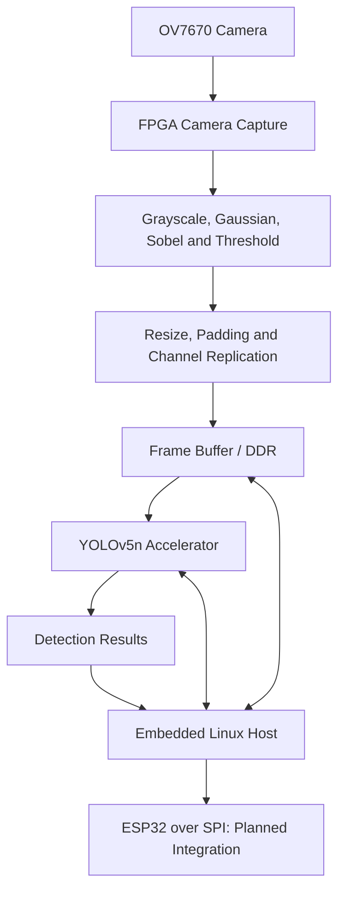

# Lightweight YOLO Acceleration on FPGA

### Edge Object Detection with Microchip PolarFire SoC and OV7670

An academic project exploring lightweight YOLO acceleration on FPGA for road-vehicle detection. The system combines an OV7670 camera, an FPGA image-processing frontend, and an embedded Linux host on the Microchip PolarFire SoC Discovery Kit.

The project investigates edge images as an input representation and studies the tradeoffs between detection accuracy, hardware resources, throughput, and power consumption. Power savings are a research objective and require measurement.

## Objectives

- Capture images from the OV7670 camera using FPGA logic.
- Extract object contours through a streaming image-processing pipeline.
- Train YOLOv5n on edge images for road-vehicle detection.
- Integrate preprocessing, memory transfers, and YOLO acceleration.
- Use embedded Linux for control, debugging, and result inspection.
- Explore ESP32 communication over SPI for external result monitoring.

## Target Architecture

This diagram describes the target integration. Complete camera-to-detection operation remains under validation.

## Hardware and Tools

| Component | Configuration |
| --- | --- |
| FPGA / SoC | Microchip PolarFire SoC MPFS095T-1FCG325E |
| Development board | MPFS Discovery Kit |
| Camera | OV7670 |
| External controller | ESP32 |
| FPGA development | Libero SoC 2025.2 |
| Programming | FlashPro |
| Embedded OS | Yocto Linux |
| Model development | Python, PyTorch, YOLOv5 v7.0 |
| Hardware description | Verilog |

## Image-Processing Pipeline

1. Convert camera pixels to grayscale.
2. Apply a Gaussian 3 × 3 filter.
3. Compute Sobel gradients using `|Gx| + |Gy|`.
4. Apply an edge threshold, initially configured to `250`.
5. Refine the binary edge image.
6. Downsample to `160 × 120` to limit frontend memory requirements.
7. Upscale to `256 × 192` using nearest-neighbor interpolation.
8. Add 32 rows of padding above and below to obtain `256 × 256`.
9. Replicate the edge image across three channels for model input.

The threshold must be tuned for camera settings and lighting conditions. Software training preprocessing and hardware preprocessing must remain consistent.

Three-channel replication matches the model input format; it does not by itself reduce the YOLO convolution workload.

## YOLO Model

| Item | Configuration |
| --- | --- |
| Model | YOLOv5n |
| Input size | 256 × 256 |
| Input representation | Edge image replicated across three channels |
| Application | Road-vehicle detection |
| Training framework | PyTorch |
| Training checkpoint | `best.pt` |
| Interchange format | ONNX export under verification |

FPGA deployment requires verification of supported operations, numerical representation, weight layout, and accelerator compatibility. A PyTorch checkpoint or ONNX file alone is not an FPGA programming image.

## Clock Domains

| Domain | Target frequency |
| --- | --- |
| Camera XCLK | 24 MHz |
| System logic | 50 MHz |
| YOLO accelerator | 75 MHz |

The OV7670 supplies its own pixel clock, which must be handled as a separate capture domain. Cross-domain transfers require appropriate synchronization or asynchronous FIFOs, with reset behavior checked in each domain.

## Development Workflow

1. Validate camera configuration, pixel capture, and frame boundaries.
2. Verify preprocessing stages against a software reference.
3. Train and evaluate YOLOv5n using matching edge-image preprocessing.
4. Verify model export and prepare accelerator-compatible weights.
5. Integrate the frontend, frame buffers, DDR transfers, and accelerator control.
6. Build the FPGA design, check timing, and program the board.
7. Boot Yocto Linux and inspect camera and accelerator status.
8. Validate detections and integrate ESP32 communication.

Exact build and run commands depend on the source files, Linux image, and accelerator register map included in the repository.

## Current Status

**In development — integration and end-to-end validation are ongoing.**

Work includes OV7670 capture debugging, edge-image preprocessing, YOLOv5n training, FPGA implementation, and Linux-based register inspection. Detection accuracy, inference speed, resource utilization, and power measurements will be reported after reproducible validation.

## Evaluation Plan

- **Detection quality:** precision, recall, and mAP on held-out edge images.
- **Throughput:** inference latency and complete camera-to-result frame rate.
- **FPGA utilization:** logic, DSP, memory, and post-route timing results.
- **Data integrity:** frame counts, dropped pixels, buffer behavior, and DDR transfers.
- **Power:** measured consumption under defined operating conditions.
- **Outdoor robustness:** exposure, gain, brightness, and edge stability.

## Author

**Võ Hoàng Huy** & **Đặng Văn Thịnh** & **Phạm Trần Bảo Long**

Electronics and Telecommunications student  
GitHub: [@huyvo11122004](https://github.com/huyvo11122004)

---

This repository documents an academic FPGA and embedded AI project. Results and implementation details will be updated as validation progresses.
